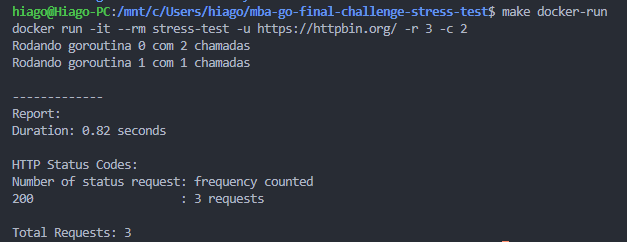

# Stress Test

## Objetivo

Criar um sistema de CLI (Command Line Interface) em Go para realizar testes de carga em serviços web. O usuário deverá fornecer a URL do serviço, o número total de requisições e a quantidade de chamadas simultâneas. Ao final, o sistema deve gerar um relatório detalhado da execução.

### Usando sem docker

Rodando com 

```bash
go run cmd/main.go --url https://httpbin.org/ --requests 3 --concurrency 2
```

Ou na forma simplificado

```bash
go run cmd/main.go -u https://httpbin.org/ -r 3 -c 2
```

> [!NOTE]
> Estou usando a url do `https://httpbin.org/` por que ele me retorna um http de 429 pra quando se faz muita chamada, em sites como o google a conexao e quebrada antes de completar totalizando um numero de chamadas menor

### Com docker

Voce vai buildar a imagem docker com nome de `stress-test` como em

```bash
make docker-build
# ou
docker build -t stress-test .
```

E rodar o comando no run com

```bash
make docker-run
# ou
docker run -it --rm stress-test -u https://httpbin.org/ -r 3 -c 2
```

Onde `-u` e o alias pra `--url`, `-r` pra `--requests` e `-c` pra `--concurrency`, fique a vontade pra trocar as variaveis a resposta e pra vir como:


